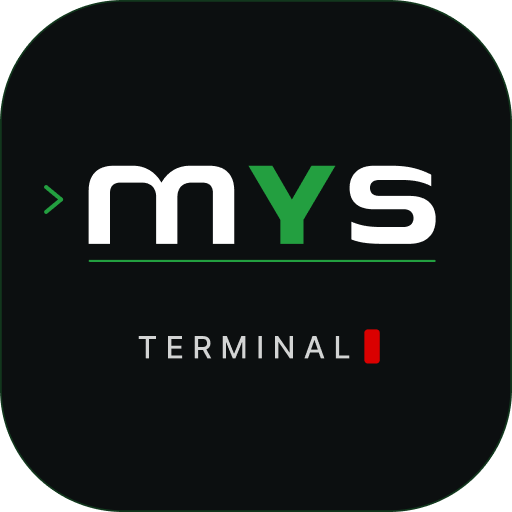
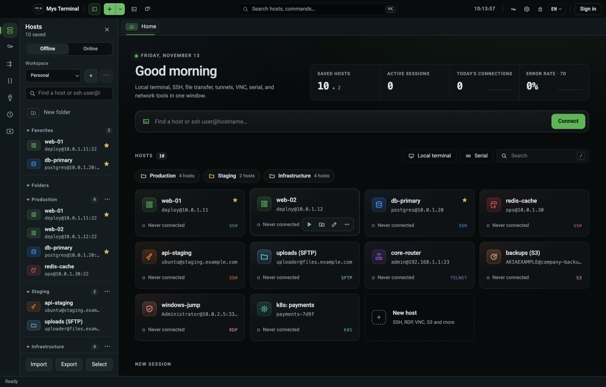
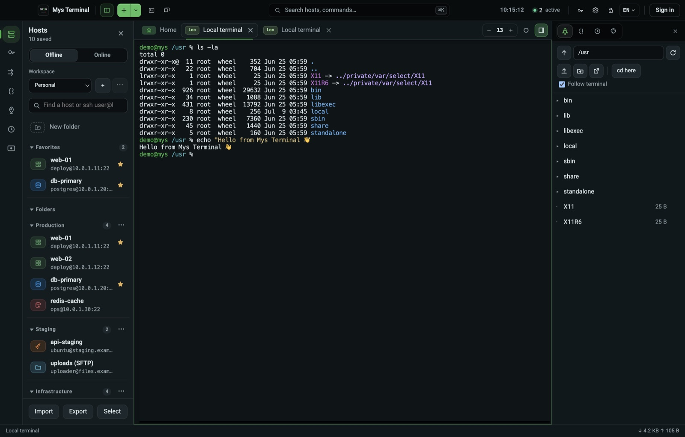
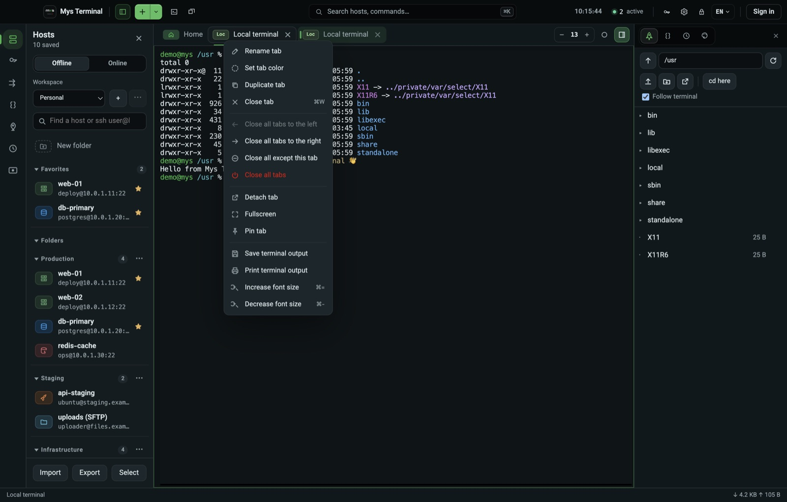
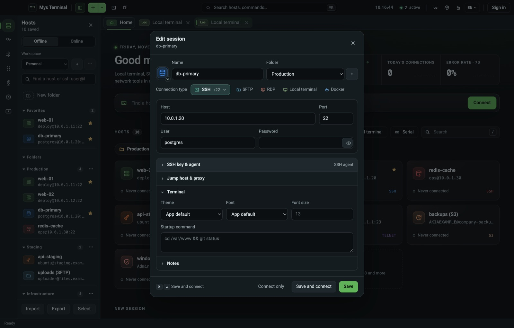
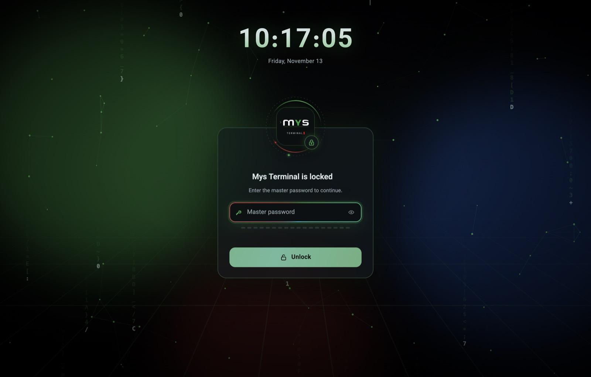
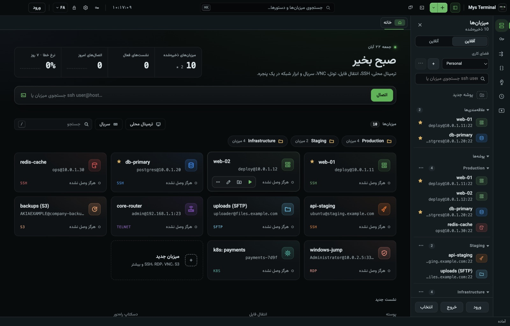
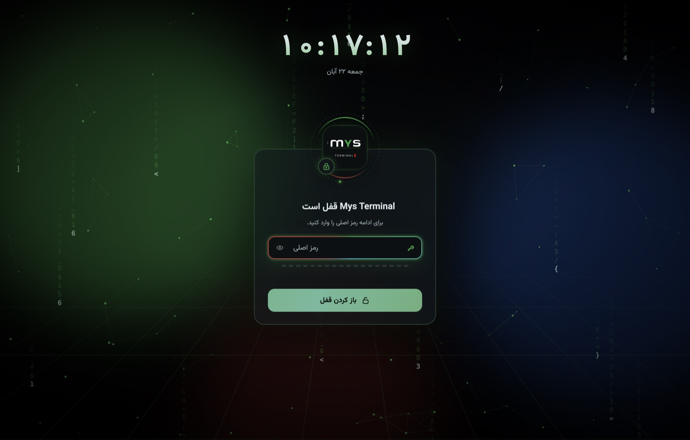

<p align="center">
  
</p>

<h1 align="center">Mys Terminal Management</h1>

<p align="center">
  <b>SSH, SFTP, RDP, VNC, tunnels, serial and local shells in one workstation.</b><br>
  <b>همه ابزارهای اتصال به سرور در یک برنامه.</b>
</p>

<p align="center">
  <a href="#english">English</a> · <a href="#فارسی">فارسی</a>
</p>

<p align="center">
  
</p>

---

<a id="english"></a>

## English

Mys Terminal Management is a desktop app for people who work with servers every day: system administrators, DevOps engineers, developers and network engineers. You keep all your hosts in one place, connect with one click, and get terminals, file transfer, tunnels and remote desktops in tabs and split panes. It runs on **macOS, Windows and Linux**, in **16 languages** (including right-to-left Persian and Arabic).

### Screenshots

| | |
|---|---|
|  |  |
| **Terminal and file panel.** The side panel follows the shell's current folder. | **Tab menu.** Rename, color, duplicate, detach, pin, save or print the output. |
|  |  |
| **Session editor.** Every protocol in one form, with per-host theme and font. | **Lock screen.** Protected by a master password, locks itself when you are away. |

<p align="center"><br><sub>The whole interface also works right-to-left (Persian shown).</sub></p>

### Features

**Connections (16 protocols)**

| Group | Protocols |
|---|---|
| Shells | SSH, Mosh, Telnet, raw TCP, serial port, local terminal, PowerShell, WSL (Windows) |
| Files | SFTP, FTP / FTPS, Amazon S3 and S3-compatible storage |
| Remote desktop | RDP (through FreeRDP), VNC (built in) |
| Containers and cloud | Docker exec, Kubernetes exec |
| Other | Built-in web browser tab |

- **Quick connect:** type `user@host`, `ssh user@host:2222`, `sftp://…` or a URL and press Enter.
- **Jump host (ProxyJump):** reach servers through a bastion. Also SOCKS5 and HTTP proxies.
- **SSH options:** private keys, OpenSSH certificates, SSH agent, agent forwarding and X11 forwarding.
- **Tunnels:** local, remote and dynamic (SOCKS) port forwarding, saved per host.
- **Known hosts:** host keys are checked and remembered.
- **Auto reconnect:** a dropped connection reconnects with back-off. Open tabs come back after a restart.

**Tabs and windows**

- Tabs and split panes: side by side, top and bottom, or four panes.
- **Tab menu (right-click):** rename, set a color, duplicate, close (this, left, right, others, all), detach into its own window without dropping the connection, fullscreen, pin, save or print the terminal output, change the font size.
- **Multi-exec:** type once, send to every open terminal.
- Command palette (`⌘K` / `Ctrl+Shift+P`) for hosts and actions.

**Terminal**

- Fast GPU rendering (WebGL), 25 themes, and a theme, font and size of its own for each host.
- Highlights words like *error* and *warning*.
- Asks before pasting several lines at once.
- Drag a file or folder onto the terminal to type its path, quoted correctly for the shell.
- Word jumps that work in bash, zsh and fish:
  - macOS: `⌥←` / `⌥→`, `⌘←` / `⌘→`
  - Windows / Linux: `Ctrl+←` / `Ctrl+→`
- Copy and paste:
  - macOS: `⌘C` / `⌘V`
  - Windows / Linux: `Ctrl+Shift+C` / `Ctrl+Shift+V`, so `Ctrl+C` always stops the running program.
- Search in the scrollback.
- Session recording in asciicast format (play it back in the app or with asciinema), plus plain-text logs.
- ZModem and trzsz (`rz`, `sz`, `trz`, `tsz`) file transfer inside the terminal.
- Live server monitor under SSH tabs: CPU, memory, disk, network and uptime.

**Files**

- File manager for SFTP, FTP, S3 and the local disk.
- Upload, download, rename, delete, change permissions (chmod), edit text files.
- Transfer queue with pause, resume and cancel.
- Folder sync (upload or download only the changed files) and side-by-side file compare.
- Open a remote file in your own editor; every save uploads it again.
- Drag and drop: drop files onto the panel to upload, drag rows out to Finder, Explorer or the desktop to download.

**Keys, passwords and snippets**

- **Keychain:** identities, SSH keys and certificates. Generate Ed25519, ECDSA, RSA or ML-DSA keys.
- Password generator, with a history of generated passwords.
- **Snippets:** saved commands in packages, with tags and target hosts. Secret snippets are stored encrypted.

**Tools**

- Network tools: ping, traceroute, DNS lookup, whois, port check, Wake-on-LAN.
- One-click local servers (HTTP, TFTP and FTP) to share a folder on your network.

**Import and export**

- Import hosts from `~/.ssh/config`, PuTTY, MobaXterm, SecureCRT or a JSON backup.
- Export everything, a folder or a selection as JSON or CSV. Passwords are never exported.

**Security**

- Passwords, keys and secret snippets are encrypted with AES-256-GCM. The key itself is protected by your operating system's keychain (macOS Keychain, Windows DPAPI, Linux Secret Service).
- **Master password:**
  - Locks the app on start, when you press the lock button (`⌘⇧L` / `Ctrl+Shift+L`), after idle time, and when the computer sleeps or the screen locks.
  - While the app is locked, the main process refuses every request, so the lock is not just a cover over the window.
- Workspaces keep personal and team hosts apart.

**Everyday comfort**

- 16 languages: English, Persian, Arabic, German (and Austrian German), French, Spanish, Portuguese (and Brazilian), Dutch, Danish, Greek, Turkish, Russian, Chinese and Hindi.
- Clock in the title bar, automatic updates, light and dark themes.

### Install

Download the installer for your system from the project's releases page:

| System | Files |
|---|---|
| macOS (Apple Silicon and Intel) | `.dmg`, `.zip` |
| Windows (x64 and ARM64) | installer (`.exe`) and portable `.exe` |
| Linux (x64 and ARM64) | `.AppImage`, `.deb` |

**Optional programs.** Some protocols use a program installed on your computer. The app detects them automatically:

| For | Install |
|---|---|
| RDP | [FreeRDP](https://www.freerdp.com/) (`sdl-freerdp3`, `xfreerdp3` or `wfreerdp`) |
| Mosh | `mosh` |
| Docker / Kubernetes | `docker`, `kubectl` |
| X11 forwarding on macOS | [XQuartz](https://www.xquartz.org/) |
| PowerShell on macOS / Linux | `pwsh` |

### Keyboard shortcuts

| Action | macOS | Windows / Linux |
|---|---|---|
| Local terminal | `⌘T` | `Ctrl+Shift+T` |
| New session | `⌘⇧T` | `Ctrl+Shift+N` |
| Close tab | `⌘W` | `Ctrl+Shift+W` |
| Next / previous tab | `Ctrl+Tab` / `Ctrl+Shift+Tab` | `Ctrl+Tab` / `Ctrl+Shift+Tab` |
| Split vertical / horizontal | `⌘D` / `⌘⇧D` | `Ctrl+Shift+D` / `Ctrl+Shift+E` |
| Split into four | `⌥⌘D` | `Ctrl+Shift+Alt+D` |
| Find in terminal | `⌘F` | `Ctrl+Shift+F` |
| Clear terminal | `⌘⇧K` | `Ctrl+Shift+K` |
| Record session | `⌘⇧R` | `Ctrl+Shift+R` |
| Multi-exec | `⌘⇧M` | `Ctrl+Shift+M` |
| Command palette | `⌘K` | `Ctrl+Shift+P` |
| Hosts sidebar / side panel | `⌘B` / `⌥⌘B` | `Ctrl+Shift+B` / `Ctrl+Shift+Alt+B` |
| Font bigger / smaller / reset | `⌘=` / `⌘-` / `⌘0` | `Ctrl+=` / `Ctrl+-` / `Ctrl+0` |
| Password generator | `⌘⇧G` | `Ctrl+Shift+G` |
| Lock now | `⌘⇧L` | `Ctrl+Shift+L` |
| Settings | `⌘,` | `Ctrl+,` |
| Copy / paste in terminal | `⌘C` / `⌘V` | `Ctrl+Shift+C` / `Ctrl+Shift+V` |
| Word left / right in terminal | `⌥←` / `⌥→` | `Ctrl+←` / `Ctrl+→` |
| Start / end of line in terminal | `⌘←` / `⌘→` | `Home` / `End` |

### Where your data is stored

Everything stays on your computer:

| System | Folder |
|---|---|
| macOS | `~/Library/Application Support/Mys Terminal Management` |
| Windows | `%APPDATA%\Mys Terminal Management` |
| Linux | `~/.config/Mys Terminal Management` |

What is in that folder:

- `sessions.json`: hosts, folders, snippets and settings.
- `secrets.bin`: passwords, keys and the password history, encrypted.
- `auth.json`: your local account.
- `logs/` and `recordings/`: terminal logs and session recordings.

Development builds use a separate folder whose name ends in `(Dev)`.

### Build from source

You need **Node.js 20 or newer**.

```bash
npm install          # install dependencies (also prepares node-pty)
npm run dev          # start the app in development mode
npm test             # run the tests
npm run typecheck    # check TypeScript types
npm run build        # production build into out/
npm run dist:mac     # macOS installers  (also: dist:win, dist:linux)
```

In development, changes to the interface reload by themselves. Changes in `src/main` or `src/preload` need a restart of `npm run dev`.

If the local terminal fails with `posix_spawnp failed` after building for another CPU type, run `npm run rebuild`.

### Project layout

```
src/main/       Electron main process: connections, files, storage, lock, updates
src/preload/    the safe bridge between the window and the main process
src/renderer/   React interface: tabs, terminal, file panel, dialogs
src/shared/     types, the IPC contract, translations (src/shared/i18n)
tests/          Vitest tests
docs/           notes, backend spec, screenshots
```

### License

This project is free for personal, educational, and non-commercial use
under the PolyForm Noncommercial License 1.0.0.

Commercial use (any use in a product or service that generates revenue)
requires a paid commercial license. Contact: your-email@example.com

---

<a id="فارسی"></a>

<div dir="rtl">

## فارسی

Mys Terminal Management یک برنامه دسکتاپ برای کسانی است که هر روز با سرور کار می‌کنند: مدیران سیستم، مهندسان DevOps، برنامه‌نویسان و مهندسان شبکه. همه سرورهایتان یک جا ذخیره می‌شوند، با یک کلیک وصل می‌شوید، و ترمینال، انتقال فایل، تونل و دسکتاپ راه دور را در تب‌ها و پنجره‌های تقسیم‌شده دارید. برنامه روی **مک، ویندوز و لینوکس** کار می‌کند و **۱۶ زبان** دارد، از جمله فارسی و عربی با چیدمان راست‌به‌چپ.

### تصویرها

| | |
|---|---|
|  |  |
| **ترمینال و پنل فایل.** پنل کناری همراه پوشه فعلی shell جابه‌جا می‌شود. | **منوی تب.** تغییر نام، رنگ، تکثیر، جدا کردن، سنجاق، ذخیره یا چاپ خروجی. |
|  |  |
| **ویرایش نشست.** همه پروتکل‌ها در یک فرم، با تم و فونت جدا برای هر سرور. | **صفحه قفل.** با رمز اصلی محافظت می‌شود و وقتی نیستید خودش قفل می‌شود. |

### قابلیت‌ها

**اتصال‌ها (۱۶ پروتکل)**

| گروه | پروتکل‌ها |
|---|---|
| ترمینال | SSH، Mosh، Telnet، TCP خام، پورت سریال، ترمینال محلی، PowerShell، WSL (ویندوز) |
| فایل | SFTP، FTP / FTPS، Amazon S3 و فضاهای سازگار با S3 |
| دسکتاپ راه دور | RDP (با FreeRDP)، VNC (داخلی) |
| کانتینر و ابر | Docker exec، Kubernetes exec |
| دیگر | تب مرورگر داخلی |

- **اتصال سریع:** `user@host`، `ssh user@host:2222`، `sftp://…` یا یک آدرس وب را بنویسید و Enter بزنید.
- **سرور واسط (Jump host):** اتصال از طریق یک سرور واسط (bastion)، و همچنین پروکسی SOCKS5 و HTTP.
- **گزینه‌های SSH:** کلید خصوصی، گواهی OpenSSH، SSH agent، انتقال agent و X11 forwarding.
- **تونل:** پورت فورواردینگ محلی، معکوس و پویا (SOCKS) که برای هر سرور ذخیره می‌شود.
- **Known hosts:** کلید سرورها بررسی و به خاطر سپرده می‌شود.
- **اتصال دوباره خودکار:** اتصال قطع‌شده خودش دوباره وصل می‌شود و تب‌های باز بعد از بستن برنامه برمی‌گردند.

**تب‌ها و پنجره‌ها**

- تب و تقسیم صفحه: کنار هم، بالا و پایین، یا چهار بخش.
- **منوی تب (راست‌کلیک):** تغییر نام، رنگ، تکثیر، بستن (همین تب، چپ، راست، بقیه، همه)، جدا کردن در پنجره‌ای مستقل بدون قطع اتصال، تمام‌صفحه، سنجاق، ذخیره یا چاپ خروجی ترمینال، تغییر اندازه فونت.
- **اجرای همزمان:** یک بار تایپ کنید، به همه ترمینال‌های باز فرستاده می‌شود.
- جعبه فرمان (`⌘K` یا `Ctrl+Shift+P`) برای پیدا کردن سرورها و کارها.

**ترمینال**

- نمایش سریع با کارت گرافیک (WebGL)، ۲۵ تم، و تم و فونت و اندازه جدا برای هر سرور.
- رنگی کردن کلمه‌هایی مثل *error* و *warning*.
- پرسیدن پیش از چسباندن چند خط با هم.
- با کشیدن فایل یا پوشه روی ترمینال، مسیرش با نقل‌قول درست تایپ می‌شود.
- پرش بین کلمه‌ها که در bash، zsh و fish کار می‌کند:
  - مک: `⌥←` / `⌥→`، `⌘←` / `⌘→`
  - ویندوز و لینوکس: `Ctrl+←` / `Ctrl+→`
- کپی و چسباندن:
  - مک: `⌘C` / `⌘V`
  - ویندوز و لینوکس: `Ctrl+Shift+C` / `Ctrl+Shift+V`، تا `Ctrl+C` همیشه برنامه در حال اجرا را متوقف کند.
- جستجو در متن ترمینال.
- ضبط جلسه با فرمت asciicast (پخش در خود برنامه یا با asciinema) و لاگ متنی.
- انتقال فایل با ZModem و trzsz (`rz`، `sz`، `trz`، `tsz`) داخل ترمینال.
- مانیتور زنده سرور زیر تب‌های SSH: پردازنده، حافظه، دیسک، شبکه و مدت روشن بودن.

**فایل‌ها**

- مدیر فایل برای SFTP، FTP، S3 و دیسک محلی.
- آپلود، دانلود، تغییر نام، حذف، تغییر دسترسی (chmod) و ویرایش فایل متنی.
- صف انتقال با توقف، ادامه و لغو.
- همگام‌سازی پوشه (فقط فایل‌های تغییرکرده) و مقایسه دو فایل کنار هم.
- باز کردن فایل سرور در ادیتور خودتان؛ با هر ذخیره دوباره آپلود می‌شود.
- کشیدن و رها کردن: فایل را روی پنل رها کنید تا آپلود شود، یا ردیف را به Finder، Explorer یا دسکتاپ بکشید تا دانلود شود.

**کلید، رمز و اسنیپت**

- **Keychain:** هویت‌ها، کلیدهای SSH و گواهی‌ها. ساخت کلید Ed25519، ECDSA، RSA یا ML-DSA.
- رمزساز، همراه با تاریخچه رمزهای ساخته‌شده.
- **اسنیپت:** دستورهای ذخیره‌شده در بسته‌ها، با برچسب و سرور مقصد. اسنیپت‌های محرمانه رمزنگاری‌شده ذخیره می‌شوند.

**ابزارها**

- ابزارهای شبکه: ping، traceroute، جستجوی DNS، whois، بررسی پورت، Wake-on-LAN.
- سرورهای محلی با یک کلیک (HTTP، TFTP و FTP) برای اشتراک یک پوشه در شبکه.

**ورود و خروجی گرفتن**

- وارد کردن سرورها از `~/.ssh/config`، PuTTY، MobaXterm، SecureCRT یا پشتیبان JSON.
- خروجی گرفتن از همه، یک پوشه یا موارد انتخاب‌شده با فرمت JSON یا CSV. رمزها هیچ‌وقت در خروجی نمی‌آیند.

**امنیت**

- رمزها، کلیدها و اسنیپت‌های محرمانه با AES-256-GCM رمزنگاری می‌شوند و خود کلید را keychain سیستم‌عامل نگه می‌دارد (Keychain مک، DPAPI ویندوز، Secret Service لینوکس).
- **رمز اصلی:**
  - برنامه را هنگام باز شدن، با دکمه قفل (`⌘⇧L` یا `Ctrl+Shift+L`)، بعد از مدتی بیکاری، و هنگام خواب رفتن کامپیوتر یا قفل شدن صفحه قفل می‌کند.
  - تا وقتی قفل است، فرایند اصلی به هیچ درخواستی جواب نمی‌دهد. پس قفل فقط یک پوشش روی پنجره نیست.
- فضاهای کاری، سرورهای شخصی و تیمی را از هم جدا نگه می‌دارند.

**راحتی روزمره**

- ۱۶ زبان: انگلیسی، فارسی، عربی، آلمانی (و آلمانی اتریش)، فرانسوی، اسپانیایی، پرتغالی (و برزیلی)، هلندی، دانمارکی، یونانی، ترکی، روسی، چینی و هندی.
- ساعت در نوار بالا، به‌روزرسانی خودکار، تم‌های روشن و تیره.

### نصب

نصب‌کننده سیستم‌عامل خود را از صفحه نسخه‌های (Releases) پروژه دانلود کنید:

| سیستم‌عامل | فایل‌ها |
|---|---|
| مک (Apple Silicon و Intel) | `.dmg`، `.zip` |
| ویندوز (x64 و ARM64) | نصب‌کننده (`.exe`) و نسخه قابل‌حمل `.exe` |
| لینوکس (x64 و ARM64) | `.AppImage`، `.deb` |

**برنامه‌های اختیاری.** بعضی پروتکل‌ها از برنامه‌ای که روی کامپیوترتان نصب است استفاده می‌کنند. برنامه آن‌ها را خودکار پیدا می‌کند:

| برای | نصب کنید |
|---|---|
| RDP | [FreeRDP](https://www.freerdp.com/) (`sdl-freerdp3`، `xfreerdp3` یا `wfreerdp`) |
| Mosh | `mosh` |
| Docker و Kubernetes | `docker`، `kubectl` |
| X11 forwarding در مک | [XQuartz](https://www.xquartz.org/) |
| PowerShell در مک و لینوکس | `pwsh` |

### میانبرهای صفحه‌کلید

| کار | مک | ویندوز و لینوکس |
|---|---|---|
| ترمینال محلی | `⌘T` | `Ctrl+Shift+T` |
| نشست جدید | `⌘⇧T` | `Ctrl+Shift+N` |
| بستن تب | `⌘W` | `Ctrl+Shift+W` |
| تب بعدی و قبلی | `Ctrl+Tab` / `Ctrl+Shift+Tab` | `Ctrl+Tab` / `Ctrl+Shift+Tab` |
| تقسیم عمودی و افقی | `⌘D` / `⌘⇧D` | `Ctrl+Shift+D` / `Ctrl+Shift+E` |
| تقسیم به چهار | `⌥⌘D` | `Ctrl+Shift+Alt+D` |
| جستجو در ترمینال | `⌘F` | `Ctrl+Shift+F` |
| پاک کردن ترمینال | `⌘⇧K` | `Ctrl+Shift+K` |
| ضبط جلسه | `⌘⇧R` | `Ctrl+Shift+R` |
| اجرای همزمان | `⌘⇧M` | `Ctrl+Shift+M` |
| جعبه فرمان | `⌘K` | `Ctrl+Shift+P` |
| نوار سرورها و پنل کناری | `⌘B` / `⌥⌘B` | `Ctrl+Shift+B` / `Ctrl+Shift+Alt+B` |
| بزرگ‌تر، کوچک‌تر و اندازه پیش‌فرض فونت | `⌘=` / `⌘-` / `⌘0` | `Ctrl+=` / `Ctrl+-` / `Ctrl+0` |
| رمزساز | `⌘⇧G` | `Ctrl+Shift+G` |
| قفل کردن | `⌘⇧L` | `Ctrl+Shift+L` |
| تنظیمات | `⌘,` | `Ctrl+,` |
| کپی و چسباندن در ترمینال | `⌘C` / `⌘V` | `Ctrl+Shift+C` / `Ctrl+Shift+V` |
| کلمه قبل و بعد در ترمینال | `⌥←` / `⌥→` | `Ctrl+←` / `Ctrl+→` |
| ابتدا و انتهای خط در ترمینال | `⌘←` / `⌘→` | `Home` / `End` |

### داده‌ها کجا ذخیره می‌شوند

همه چیز روی کامپیوتر خودتان می‌ماند:

| سیستم‌عامل | پوشه |
|---|---|
| مک | `~/Library/Application Support/Mys Terminal Management` |
| ویندوز | `%APPDATA%\Mys Terminal Management` |
| لینوکس | `~/.config/Mys Terminal Management` |

محتوای این پوشه:

- `sessions.json`: سرورها، پوشه‌ها، اسنیپت‌ها و تنظیمات.
- `secrets.bin`: رمزها، کلیدها و تاریخچه رمزها، به‌صورت رمزنگاری‌شده.
- `auth.json`: حساب محلی شما.
- `logs/` و `recordings/`: لاگ‌ها و ضبط‌های ترمینال.

نسخه توسعه از پوشه جداگانه‌ای استفاده می‌کند که نامش با `(Dev)` تمام می‌شود.

### ساختن از کد منبع

به **Node.js نسخه ۲۰ یا بالاتر** نیاز دارید.

</div>

```bash
npm install          # نصب وابستگی‌ها (node-pty را هم آماده می‌کند)
npm run dev          # اجرای برنامه در حالت توسعه
npm test             # اجرای تست‌ها
npm run typecheck    # بررسی نوع‌های TypeScript
npm run build        # build نهایی در پوشه out/
npm run dist:mac     # ساخت نصب‌کننده مک (همچنین dist:win و dist:linux)
```

<div dir="rtl">

در حالت توسعه، تغییرهای رابط کاربری خودکار بارگذاری می‌شوند. تغییر در `src/main` یا `src/preload` به اجرای دوباره `npm run dev` نیاز دارد.

اگر بعد از build برای نوع دیگری از پردازنده، ترمینال محلی خطای `posix_spawnp failed` داد، دستور `npm run rebuild` را اجرا کنید.

### ساختار پروژه

</div>

```
src/main/       فرایند اصلی Electron: اتصال‌ها، فایل‌ها، ذخیره‌سازی، قفل، به‌روزرسانی
src/preload/    پل امن بین پنجره و فرایند اصلی
src/renderer/   رابط کاربری React: تب‌ها، ترمینال، پنل فایل، پنجره‌ها
src/shared/     نوع‌ها، قرارداد IPC، ترجمه‌ها (src/shared/i18n)
tests/          تست‌های Vitest
docs/           یادداشت‌ها، مشخصات بک‌اند، تصویرها
```

<div dir="rtl">

### مجوز

استفاده از این پروژه برای مقاصد شخصی، آموزشی و غیرتجاری رایگان است و تحت مجوز PolyForm Noncommercial License 1.0.0 منتشر شده است.

استفاده تجاری (هر نوع استفاده در محصول یا خدماتی که درآمد ایجاد می‌کند) به مجوز تجاری پولی نیاز دارد. تماس: your-email@example.com

</div>
